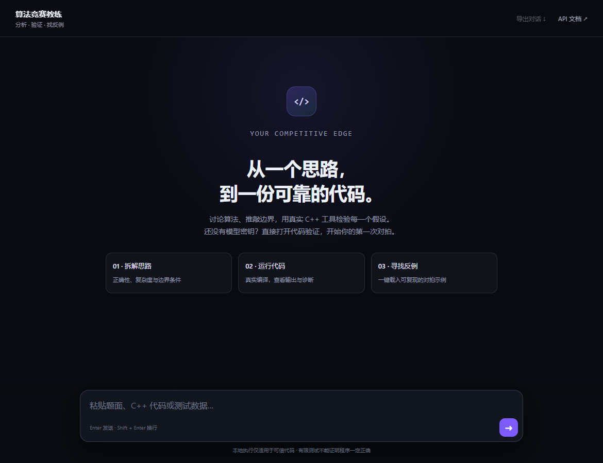
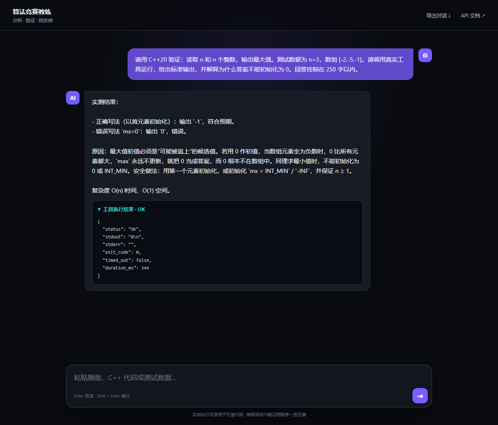
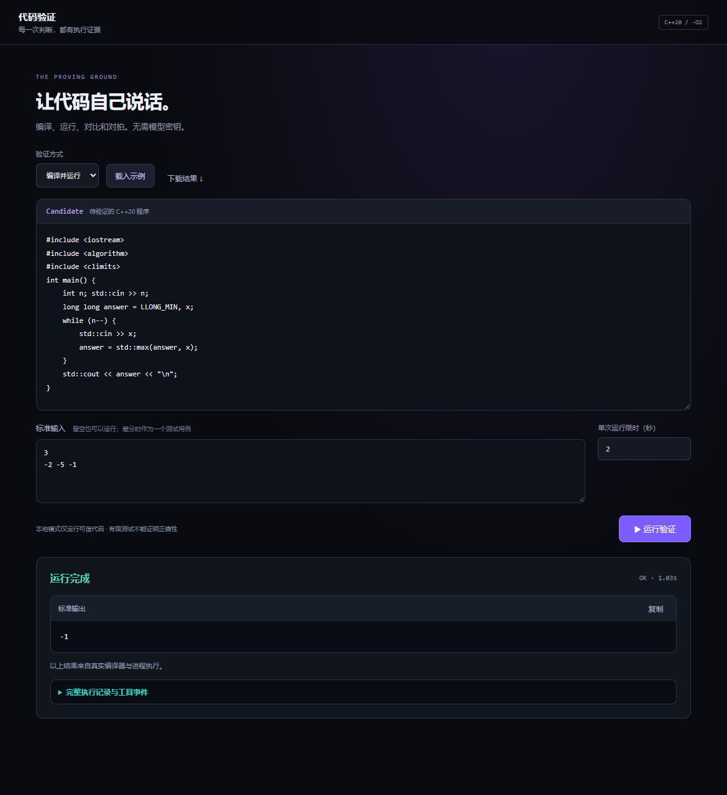
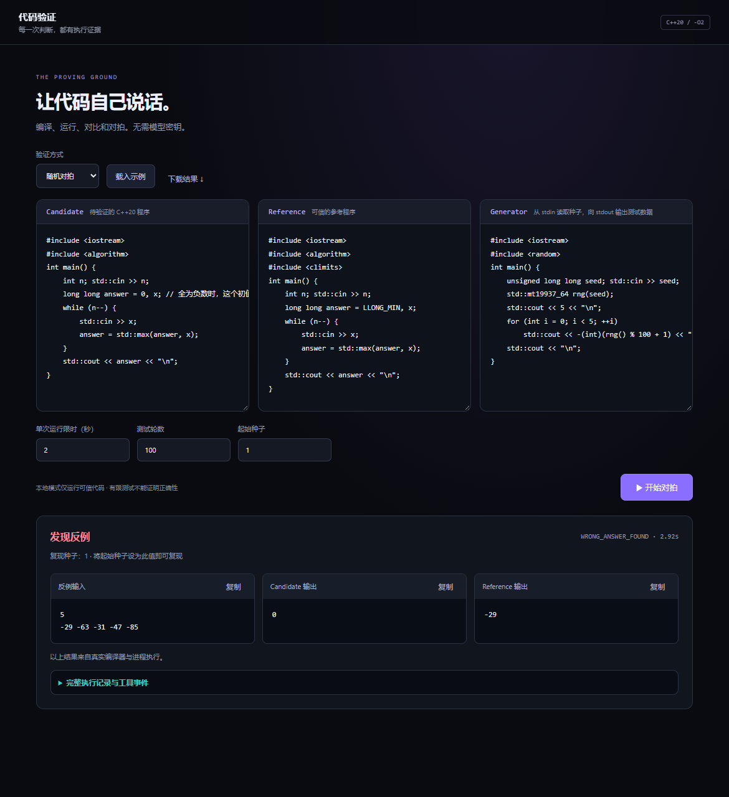
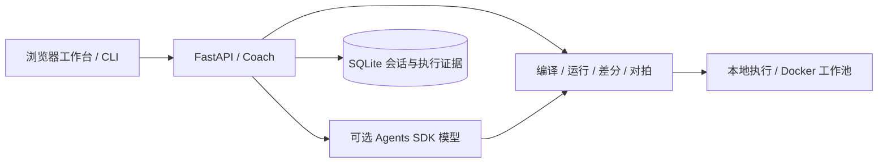

# ACM Agent

**从一个思路，到一份可靠的代码。**

DeepSeek 讲清算法与边界，真实 C++20 编译器给出执行证据。把题目、代码和疑问放进来，带着标准输出、编译诊断或可复现的反例继续改进。

[](https://github.com/Ehahaha1015/acm-agent/actions/workflows/ci.yml)

[快速启动](#快速启动) · [DeepSeek 配置](#连接-deepseek) · [密钥保护](#密钥只留在本机) · [API 与 Python 工具](#api-与-python-工具)



## 一道负数题，走完一次排错

“求数组最大值”很简单，直到所有数都是负数，而答案初值恰好写成了 `0`。

### ① 把疑问交给教练，把运行交给工具

直接问：“数组 `[-2, -5, -1]` 的最大值为什么不能从 `0` 开始算？”DeepSeek 会结合真实工具调用解释问题、复杂度和安全写法。下面是一次实际对话：正确版本得到 `-1`，错误初值的版本得到 `0`；展开的工具卡片保留了错误版本的真实输出。



### ② 写一份代码，立刻听见回声

进入 **代码验证**，粘贴代码与输入，点击运行。编译是否成功、程序输出什么、耗时多少，都来自真实进程。这个例子输入 `3 / -2 -5 -1`，标准输出就是 `-1`。



### ③ 让对拍替你撞见遗漏的边界

放入 Candidate、Reference 和读取种子的 Generator。示例在种子 `1` 找到了全负数输入：Candidate 输出 `0`，Reference 输出 `-29`。完整输入、种子和双方输出一起留在结果中；修复后用同一个种子再跑，便能检验修改。



> 上图均为本项目的实际浏览器画面。截图只包含操作区，侧栏历史对话与本地配置不入图。**有限测试和随机对拍通过都不构成正确性证明。**

| 能力 | 你会拿到什么 |
| --- | --- |
| DeepSeek 教练对话 | 算法思路、复杂度、边界分析，以及按需调用真实工具 |
| 编译 / 运行 | 编译诊断、标准输出、退出码和超时结果 |
| 差分 / 随机对拍 | 与参考程序比较，记录首个反例和可复现种子 |
| 草稿 / 会话 / 导出 | 浏览器保存代码草稿，SQLite 恢复对话，JSON 带走执行证据 |
| 离线工具模式 | 没有模型密钥也可使用完整代码验证工作台 |

## 快速启动

需要 Python 3.12+、[uv](https://docs.astral.sh/uv/getting-started/installation/) 和支持 C++20 的 `g++`。Windows 可使用 MinGW-w64，并将其 `bin` 目录加入 PATH；Ubuntu 可安装 `g++`。

```powershell
git clone https://github.com/Ehahaha1015/acm-agent.git
cd acm-agent
uv sync --frozen
uv run acm-agent --doctor
uv run acm-agent --web
```

打开 [本地工作台](http://127.0.0.1:8000)。Windows 也可执行 `powershell -ExecutionPolicy Bypass -File .\start.ps1`。服务默认只监听本机；使用 `--port 8001` 可以更换端口。

## 成品验收：不用密钥也能完成

1. 打开 **代码验证 → 编译并运行 → 载入示例 → 运行验证**。示例求负数数组的最大值，标准输出为 `-1`。
2. 切换到 **随机对拍 → 载入示例 → 开始对拍**。故意有错的 Candidate 将答案初始化为 `0`；Reference 使用 `LLONG_MIN`。页面展示 `WRONG_ANSWER_FOUND`、种子、反例输入和两份输出。
3. 将起始种子设为结果中的种子，重新执行，验证反例可复现；把 Candidate 的初值修为 `LLONG_MIN` 并添加 `<climits>`，再运行以检查修复。
4. 在运行模式中输入 `int main(){}` 并留空标准输入，可验证空输入执行。输入 `int main({` 可看到真实编译诊断；输入 `int main(){for(;;){}}` 可验证超时。
5. 在教练对话中发送下方示例。刷新后可恢复对话和工具证据；侧栏可切换、删除记录，顶部可导出 JSON。

````text
请运行下面的代码。
```cpp
#include <iostream>
int main() { std::cout << "hello\n"; }
```
输入：
```text

```
````

工作台自动在当前浏览器保存代码草稿，执行结果可复制或下载。下载 JSON 包含本次源代码、输入、结果与工具事件，便于复现。**有限测试与随机对拍通过均不构成正确性证明。**

## 连接 DeepSeek

默认接入官方 `deepseek-flash`。模型名称与 API 地址按 [DeepSeek 官方接入文档](https://api-docs.deepseek.com/) 核对；可用模型会变化，以官方文档和你的账户权限为准。

**Windows：用本地密码框录入，不把密钥写进命令行。**

```powershell
powershell -ExecutionPolicy Bypass -File .\scripts\configure-deepseek.ps1
```

在弹出的窗口中输入 API Key，点击 **Save locally**。窗口使用密码框，只把配置写入当前项目已被 Git 忽略的 `.env`，不打印密钥。随后启动或重启服务：

```powershell
uv run acm-agent --doctor
uv run acm-agent --web
```

**其他系统：** 复制 `.env.example` 为 `.env`，用本地编辑器填写 `DEEPSEEK_API_KEY`。不要把真实密钥粘贴到 README、聊天记录或终端命令中。配置结构如下，示例中的密钥字段有意留空：

```dotenv
ACM_MODEL_PROVIDER=deepseek
DEEPSEEK_API_KEY=
DEEPSEEK_MODEL=deepseek-flash
```

程序使用 `https://api.deepseek.com` 的 Chat Completions 接口。为保持模型与 C++ 工具之间的调用兼容，默认显式关闭 thinking，使用非思考模式，并限制每次模型输出长度。需要更换模型时，可在本地修改 `DEEPSEEK_MODEL`；[官方模型列表](https://api-docs.deepseek.com/quick_start/pricing/) 与 [工具调用说明](https://api-docs.deepseek.com/guides/tool_calls/) 提供当前支持情况。

验收时，侧栏应显示 **DeepSeek · deepseek-flash**。发送上面的负数数组问题，并要求真实运行；回答应附带可展开的工具结果。`--doctor` 的 `model_configured=true` 只说明配置完整，实际对话成功才说明连接可用。

模型未配置时，代码验证照常工作。模型暂不可用但本地工具已经完成时，返回已有的真实执行证据。鉴权失败请检查密钥，余额不足请在 DeepSeek 控制台处理；不要把含密钥的配置文件上传排错。

<details>
<summary>连接其他 OpenAI 兼容服务</summary>

在 `.env` 中改为 `ACM_MODEL_PROVIDER=openai`，填写 `OPENAI_API_KEY`、`OPENAI_MODEL` 与可选 `OPENAI_BASE_URL`。服务需要支持 Chat Completions 工具调用。

</details>

## 密钥只留在本机

- `.env`、`.env.*`、`secrets/` 和 `*.key` 被 Git 忽略；仓库仅保留空密钥的 `.env.example`。
- Docker 构建同样排除本地配置。`.env` 被直接读入配置对象，不写入 C++ 子进程继承的环境变量。
- `/status` 和 `--doctor` 只展示模型名与配置状态。模型异常回传前脱敏，SDK tracing 关闭。
- 本地提交钩子会检查暂存区，拦截被强行加入的 `.env`、本机实际密钥、常见 API Key 与私钥文本。检查失败只报告文件路径，不显示密钥。

首次克隆后，可启用提交与推送前检查：

```bash
git config core.hooksPath .githooks
uv run python scripts/check_secrets.py --all
```

GitHub CI 也会扫描跟踪文件。提交前检查不能替代人工核对：不要使用 `git add -f .env`，也不要绕过检查钩子。截图和日志分享前同样检查内容。

## CLI 与持久会话

CLI 支持多行粘贴与持久会话：

```bash
uv run acm-agent
# 输入 /paste，粘贴多行内容，以单独一行 /end 结束；exit 退出
uv run acm-agent --session <已有会话ID>
```

## 执行模式与限制

默认 `ACM_EXECUTOR=local` 直接在本机运行程序，**仅用于自己信任的代码**。不要将该服务直接暴露到公网。代码与输入各限 100000 字符，HTTP 工作台最多同时接纳两个执行任务，超额返回 429。运行输出每个流最多捕获 1 MiB 字符，超过后终止进程并报告 `OUTPUT_LIMIT_EXCEEDED`，不会将截断输出误判为通过。

使用 Docker 执行后端前，先启动 Docker 并准备镜像：

```bash
docker pull gcc:14
```

```dotenv
ACM_EXECUTOR=docker
ACM_DOCKER_IMAGE=gcc:14
ACM_DOCKER_WORKERS=2
ACM_DOCKER_MEMORY=256m
ACM_DOCKER_CPUS=1.0
ACM_DOCKER_NETWORK=false
```

Docker 后端使用只读根文件系统、临时工作目录、网络关闭、CPU/内存/进程数限制和降权参数。一项差分或对拍任务租用一个工作节点，各程序使用独立目录；单节点也能完成对拍。模型工具遵循同一执行后端，Docker 不可用时返回 `SANDBOX_UNAVAILABLE`，不会回退到本机执行。容器与节点会复用，这不是面向敌对多租户提交的完整在线评测沙箱。

Web 随机对拍限 1–1000 轮、单次运行限时 0.05–10 秒，对拍总预算 30 秒（包含编译；边界处可能等待当前操作结束）。预算耗尽返回 `STRESS_TIME_LIMIT`，不报告通过。默认编译限时 10 秒，Windows 首次启动编译器较慢时可调高 `ACM_COMPILE_TIMEOUT_MS`。`ACM_DATABASE` 可指定 SQLite 路径；旧数据库会自动增加工具结果字段并保留已有消息。

也可以把整个 Web 应用放入容器（内部默认依然是本地执行模式）：

```bash
docker build -t acm-agent .
docker run --rm -p 127.0.0.1:8000:8000 --env-file .env -v acm-data:/app/workspace acm-agent
```

## API 与 Python 工具

交互文档：[本地 OpenAPI](http://127.0.0.1:8000/docs)。

| 方法与路径 | 用途 |
| --- | --- |
| `GET /health` | 服务存活状态 |
| `GET /status` | 执行模式、编译器是否在 PATH、模型配置状态；不含密钥，不探测 Docker 守护进程 |
| `POST /execute` | 结构化编译、运行、差分与对拍；返回 `result`、`trace`、`duration_ms` |
| `POST /chat` | `{message, session_id?}`，返回回答、会话 ID 与工具证据 |
| `GET /sessions` | 最近 100 段对话 |
| `GET /sessions/{id}/messages` | 恢复消息与工具证据 |
| `DELETE /sessions/{id}` | 删除会话及消息 |

`/execute` 请求示例：

```json
{"mode":"run","code":"#include <iostream>\nint main(){std::cout<<42;}","input_data":"","timeout":2}
```

差分模式提供 `reference_code` 与 `test_cases`（最多 100 个、总长度最多 100000 字符）；不传用例列表时，以 `input_data` 作为单个用例。对拍模式再提供 `generator_code`、`iterations` 和 `start_seed`。生成器从 stdin 读取种子，向 stdout 输出非空测试输入；比较时忽略空白差异。

```python
from acm_agent.tools import compare_cpp, judge_cpp, stress_cpp
from acm_agent.tools.cpp_tools import check_cpp

check_cpp("int main(){}")  # 遵循所选后端并清理临时文件
judge_cpp(candidate_code, "3\n-2 -5 -1\n")
compare_cpp(candidate_code, reference_code, ["3\n-2 -5 -1\n"])
stress_cpp(candidate_code, reference_code, generator_code,
           iterations=100, start_seed=1, budget_seconds=30)
```

底层兼容接口 `compile_cpp` / `run_cpp` 面向可信本地程序，并保留可执行文件供调用者使用；Web 与模型使用会清理工作目录的后端接口。

## 开发与验证

```bash
uv sync --frozen
uv run ruff check .
uv run pytest -q
uv run python scripts/check_secrets.py --all
node --check src/acm_agent/api/web/app.js
node --check src/acm_agent/api/web/lab.js
```

自动化测试不需要密钥，使用隔离 SQLite 数据库，并显式屏蔽本机模型配置，避免测试产生真实 API 费用。覆盖真实 C++ 编译运行、超时、差分反例、种子复现、API 校验、会话迁移恢复、输出上限、DeepSeek 参数兼容、错误脱敏和提交前密钥拦截。Docker 调度采用可控 transport 测试；真实容器运行还依赖本机 Docker 守护进程和镜像。CI 在 Python 3.12 / 3.13 上执行密钥检查、Ruff 与 pytest。

### 本次实测记录

2026-11-23：Windows 本机已实际连接 DeepSeek，完成“生成 C++ → 工具执行 → 解释负数初始化错误”的完整调用。工作台运行示例输出 `-1`；随机对拍种子 `1` 找到 Candidate `0` / Reference `-29` 的反例。文中截图来自这些实际操作，密钥与个人历史记录未入图。


