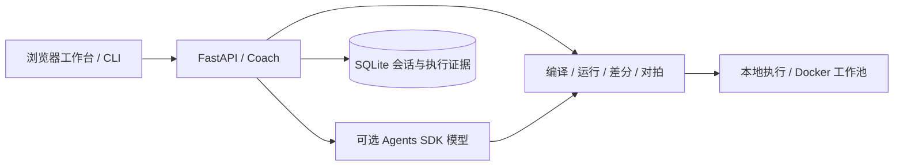

# ACM Agent

**讨论算法，用真实执行检验思路。** 支持 C++20 编译、运行、差分测试与随机对拍的算法竞赛教练，提供浏览器工作台和 CLI。离线工具无需 API 密钥；配置模型后可进行算法讲解和工具调用。

## 快速启动

需要 Python 3.12+、[uv](https://docs.astral.sh/uv/getting-started/installation/) 和支持 C++20 的 `g++`。Windows 可使用 MinGW-w64，并将其 `bin` 目录加入 PATH；Ubuntu 可安装 `g++`。

```powershell
git clone https://github.com/Ehahaha1015/acm-agent.git
cd acm-agent
uv sync --frozen
uv run acm-agent --doctor
uv run acm-agent --web
```

打开 [本地工作台](http://127.0.0.1:8000)。Windows 也可执行 `powershell -ExecutionPolicy Bypass -File .\start.ps1`。服务默认只监听本机；使用 `--port 8001` 可以更换端口。

## 成品验收：不用密钥也能完成

1. 打开 **代码验证 → 编译并运行 → 载入示例 → 运行验证**。示例求负数数组的最大值，标准输出为 `-1`。
2. 切换到 **随机对拍 → 载入示例 → 开始对拍**。故意有错的 Candidate 将答案初始化为 `0`；Reference 使用 `LLONG_MIN`。页面展示 `WRONG_ANSWER_FOUND`、种子、反例输入和两份输出。
3. 将起始种子设为结果中的种子，重新执行，验证反例可复现；把 Candidate 的初值修为 `LLONG_MIN` 并添加 `<climits>`，再运行以检查修复。
4. 在运行模式中输入 `int main(){}` 并留空标准输入，可验证空输入执行。输入 `int main({` 可看到真实编译诊断；输入 `int main(){for(;;){}}` 可验证超时。
5. 在教练对话中发送下方示例。刷新后可恢复对话和工具证据；侧栏可切换、删除记录，顶部可导出 JSON。

````text
请运行下面的代码。
```cpp
#include <iostream>
int main() { std::cout << "hello\n"; }
```
输入：
```text

```
````

工作台自动在当前浏览器保存代码草稿，执行结果可复制或下载。下载 JSON 包含本次源代码、输入、结果与工具事件，便于复现。**有限测试与随机对拍通过均不构成正确性证明。**

## 连接模型

复制 `.env.example` 为 `.env`，填写自己的配置，重启服务：

```dotenv
OPENAI_API_KEY=你的密钥
OPENAI_MODEL=供应商支持的模型名称
OPENAI_BASE_URL=
```

使用兼容 OpenAI Chat Completions 的网关时填写其 `OPENAI_BASE_URL`，且网关必须支持工具调用。密钥只保存在本机 `.env`，不会下发浏览器。未配置模型时聊天会说明离线状态，代码工具仍可使用。模型暂不可用时，已经获得的本地执行证据仍会返回。

CLI 支持多行粘贴与持久会话：

```bash
uv run acm-agent
# 输入 /paste，粘贴多行内容，以单独一行 /end 结束；exit 退出
uv run acm-agent --session <已有会话ID>
```

## 执行模式与限制

默认 `ACM_EXECUTOR=local` 直接在本机运行程序，**仅用于自己信任的代码**。不要将该服务直接暴露到公网。代码与输入各限 100000 字符，HTTP 工作台最多同时接纳两个执行任务，超额返回 429。运行输出每个流最多捕获 1 MiB 字符，超过后终止进程并报告 `OUTPUT_LIMIT_EXCEEDED`，不会将截断输出误判为通过。

使用 Docker 执行后端前，先启动 Docker 并准备镜像：

```bash
docker pull gcc:14
```

```dotenv
ACM_EXECUTOR=docker
ACM_DOCKER_IMAGE=gcc:14
ACM_DOCKER_WORKERS=2
ACM_DOCKER_MEMORY=256m
ACM_DOCKER_CPUS=1.0
ACM_DOCKER_NETWORK=false
```

Docker 后端使用只读根文件系统、临时工作目录、网络关闭、CPU/内存/进程数限制和降权参数。一项差分或对拍任务租用一个工作节点，各程序使用独立目录；单节点也能完成对拍。模型工具遵循同一执行后端，Docker 不可用时返回 `SANDBOX_UNAVAILABLE`，不会回退到本机执行。容器与节点会复用，这不是面向敌对多租户提交的完整在线评测沙箱。

Web 随机对拍限 1–1000 轮、单次运行限时 0.05–10 秒，对拍总预算 30 秒（包含编译；边界处可能等待当前操作结束）。预算耗尽返回 `STRESS_TIME_LIMIT`，不报告通过。默认编译限时 10 秒，Windows 首次启动编译器较慢时可调高 `ACM_COMPILE_TIMEOUT_MS`。`ACM_DATABASE` 可指定 SQLite 路径；旧数据库会自动增加工具结果字段并保留已有消息。

也可以把整个 Web 应用放入容器（内部默认依然是本地执行模式）：

```bash
docker build -t acm-agent .
docker run --rm -p 127.0.0.1:8000:8000 --env-file .env -v acm-data:/app/workspace acm-agent
```

## API 与 Python 工具

交互文档：[本地 OpenAPI](http://127.0.0.1:8000/docs)。

| 方法与路径 | 用途 |
| --- | --- |
| `GET /health` | 服务存活状态 |
| `GET /status` | 执行模式、编译器是否在 PATH、模型配置状态；不含密钥，不探测 Docker 守护进程 |
| `POST /execute` | 结构化编译、运行、差分与对拍；返回 `result`、`trace`、`duration_ms` |
| `POST /chat` | `{message, session_id?}`，返回回答、会话 ID 与工具证据 |
| `GET /sessions` | 最近 100 段对话 |
| `GET /sessions/{id}/messages` | 恢复消息与工具证据 |
| `DELETE /sessions/{id}` | 删除会话及消息 |

`/execute` 请求示例：

```json
{"mode":"run","code":"#include <iostream>\nint main(){std::cout<<42;}","input_data":"","timeout":2}
```

差分模式提供 `reference_code` 与 `test_cases`（最多 100 个、总长度最多 100000 字符）；不传用例列表时，以 `input_data` 作为单个用例。对拍模式再提供 `generator_code`、`iterations` 和 `start_seed`。生成器从 stdin 读取种子，向 stdout 输出非空测试输入；比较时忽略空白差异。

```python
from acm_agent.tools import compare_cpp, judge_cpp, stress_cpp
from acm_agent.tools.cpp_tools import check_cpp

check_cpp("int main(){}")  # 遵循所选后端并清理临时文件
judge_cpp(candidate_code, "3\n-2 -5 -1\n")
compare_cpp(candidate_code, reference_code, ["3\n-2 -5 -1\n"])
stress_cpp(candidate_code, reference_code, generator_code,
           iterations=100, start_seed=1, budget_seconds=30)
```

底层兼容接口 `compile_cpp` / `run_cpp` 面向可信本地程序，并保留可执行文件供调用者使用；Web 与模型使用会清理工作目录的后端接口。

## 开发与验证

```bash
uv sync --frozen
uv run ruff check .
uv run pytest -q
node --check src/acm_agent/api/web/app.js
node --check src/acm_agent/api/web/lab.js
```

测试不需要密钥，使用隔离 SQLite 数据库。覆盖真实 C++ 编译运行、超时、差分反例、种子复现、API 校验、会话迁移恢复、输出上限、模型工具后端选择，以及单节点 Docker 调度与执行路径。Docker 调度采用可控 transport 测试；真实容器运行还依赖本机 Docker 守护进程和镜像。CI 在 Python 3.12 / 3.13 上执行 Ruff 与 pytest。


